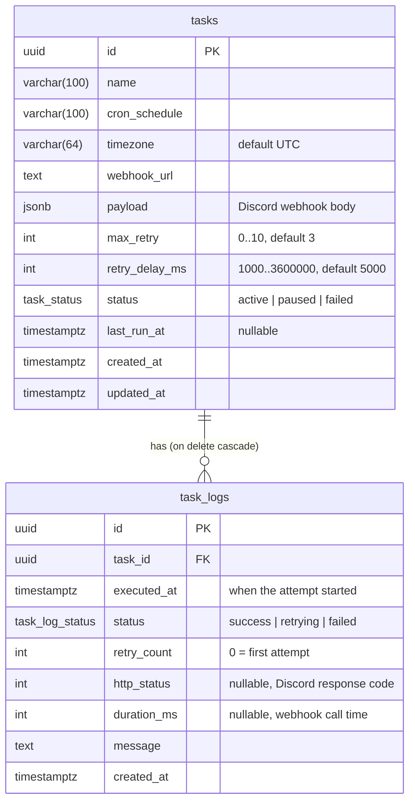

# Database schema

PostgreSQL. The schema is defined in TypeScript in
[backend/src/infrastructure/database/schema.ts](../backend/src/infrastructure/database/schema.ts);
drizzle-kit generates SQL migrations from it into [backend/drizzle/](../backend/drizzle/). No SQL is
written by hand.



## Design notes

| Decision | Reason |
|---|---|
| One `task_logs` row per attempt | Shows each retry with its own status and error in the log viewer |
| `task_log_status` has `retrying` | Separates "failed but will retry" from "failed, retries exhausted" |
| Enums for status | Postgres rejects unknown values; values come from `src/domain/task.ts` |
| Check constraints on `max_retry` and `retry_delay_ms` | Same bounds as API validation, enforced again by the database |
| `ON DELETE CASCADE` on `task_logs.task_id` | Deleting a task removes its history; no orphan rows |
| `executed_at` plus `duration_ms` | Covers both meanings of "execution time" in the brief |
| Index `(task_id, created_at DESC)` | Per-task log page, newest first |
| Index `created_at DESC` on `task_logs` | Global log page and dashboard "recent executions" |
| Index `status` on `tasks` | Dashboard counts and status filter |
| `timestamptz` everywhere | Cron runs in a task's own timezone; storage stays unambiguous |

## Commands

```bash
cd backend
npm run db:generate   # after changing schema.ts: writes a new migration into drizzle/
npm run db:migrate    # apply pending migrations (the API also does this at boot)
npm run db:studio     # browse data with Drizzle Studio
```

A unit test fails if `schema.ts` and the committed migrations drift apart.
